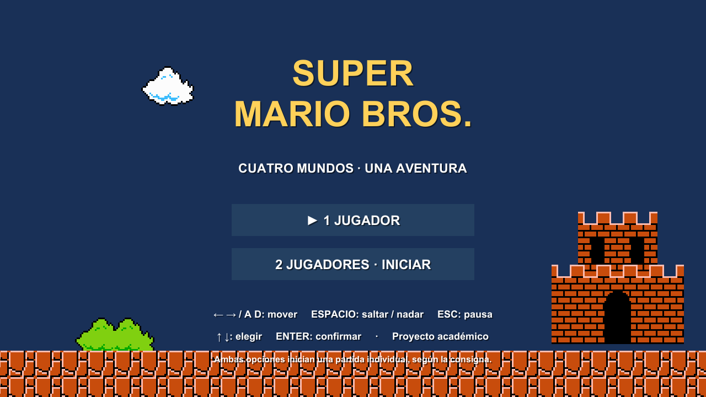
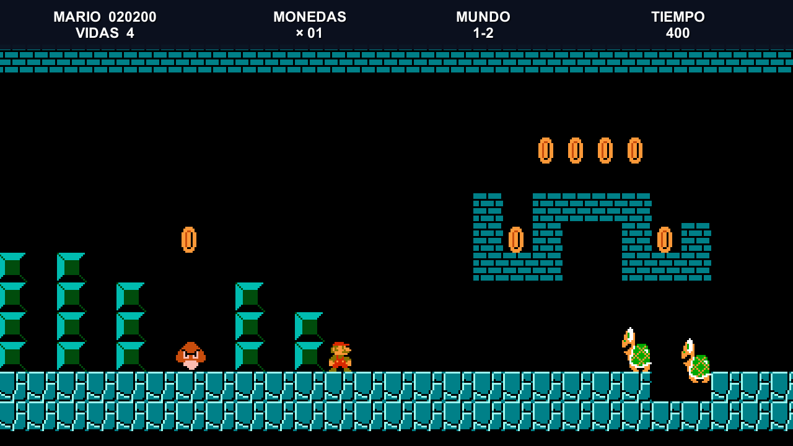
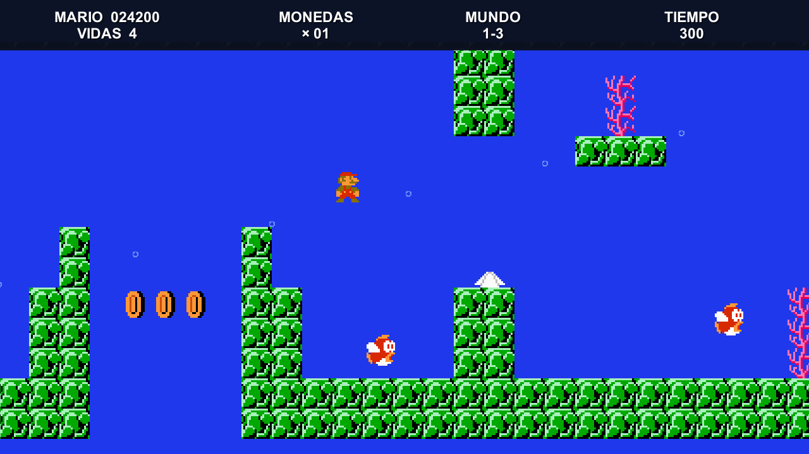
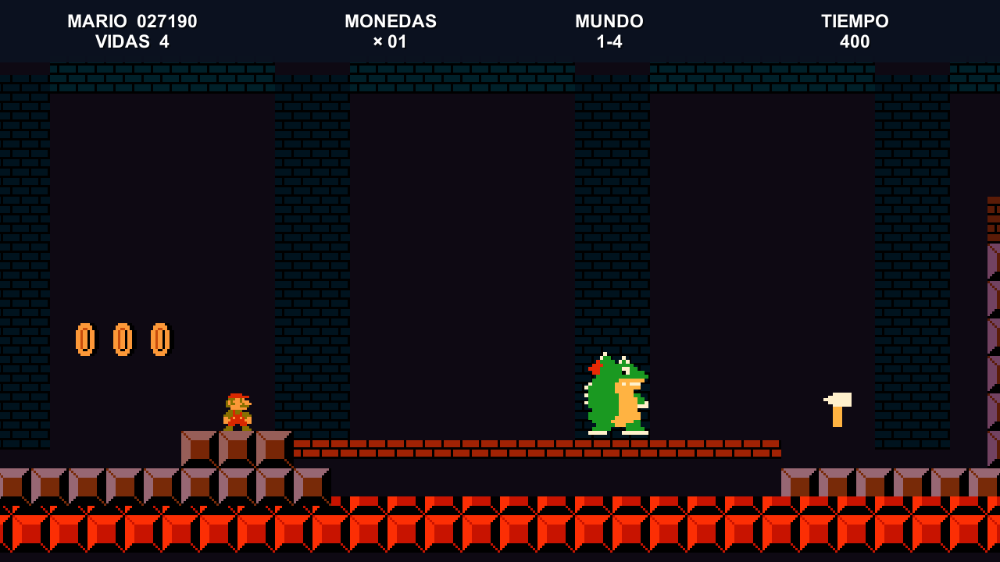
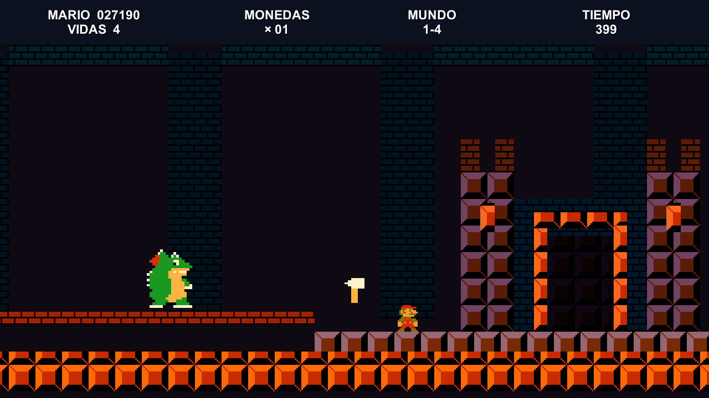
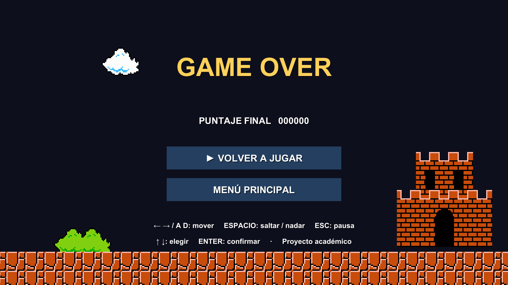

# Super Mario — campaña de Unity

Proyecto académico desarrollado como fork de [Jesusbautistah/SUPER-MArio](https://github.com/Jesusbautistah/SUPER-MArio). Conserva el nivel inicial y los assets del proyecto base, y agrega una campaña de cuatro niveles.

**Repositorio de entrega:** https://github.com/Galileya/SUPER-MArio

## Ejecutar

1. Instalar **Unity 6000.3.16f1** desde Unity Hub.
2. Clonar este repositorio y agregar su carpeta desde **Add project from disk**.
3. Abrir `Assets/Scenes/Menu.unity` y presionar **Play**.
4. Para exportar: **File → Build Profiles → Windows**, con las siete escenas de Build Settings. El menú debe permanecer primero.

El ejecutable local generado durante la validación está en `Builds/Windows/Mario.exe`. La carpeta completa es necesaria para ejecutarlo; no basta con copiar el `.exe`. Los binarios y la caché de Unity están excluidos de Git.

## Mejoras implementadas

| Requisito | Implementación |
| --- | --- |
| Menú interactuable | Opciones con mouse o flechas y Enter. Ambas inician una partida individual, como permite la consigna. |
| Sonido ambiente | Temas originales distintos para superficie, subterráneo, agua y castillo. |
| SFX | Salto, pisotón, moneda, powerup, daño, muerte, natación, fuego, interruptor, final y Game Over. |
| Contadores | Tiempo restante, puntaje, monedas, vidas y mundo. |
| Puntaje | Moneda: 200; Goomba: 100; Koopa y enemigo acuático: 200; Bowser: 5000; tiempo restante al terminar: 10 por segundo. |
| Vidas | Tres iniciales; 100 monedas dan una vida. Morir reinicia el nivel y conserva el progreso de la sesión. |
| Subterráneo | Geometría trazada del mapa NES 1-2, bloques, monedas, grupos de enemigos y ascensores. |
| Acuático | Geometría trazada del mapa NES 2-2, presentada como 1-3 de esta campaña; natación con impulsos, corales, Blooper, Cheep Cheep y burbujas. |
| Game Over | Escena independiente al perder la última vida, puntaje final y opciones de reintentar o regresar al menú. |
| Castillo original | Recorrido propio de lava, pilares y plataformas móviles; fortaleza de dos torres y portón construida bloque por bloque, sin el prefab `Castle`; Bowser patrulla, salta y dispara; el hacha derrumba el puente y abre la victoria. |
| Animaciones y cámara | Sprites animados del proyecto base, daño y crecimiento, enemigos acuáticos oscilantes, burbujas, lava pulsante, caída de Bowser y desplazamiento suavizado y acotado. |
| Pausa | Escape suspende la física y el reloj; permite continuar o volver al menú. |

**Ruta:** Menú → 1-1 superficie → 1-2 subterráneo → 1-3 acuático → 1-4 castillo → Victoria.

Los niveles de referencia reconstruyen la distribución de bloques; las físicas, tiempos, grupos de enemigos y transiciones están adaptados a este proyecto. No se afirma equivalencia píxel por píxel con la ROM. Las tuberías de la zona warp continúan la campaña requerida.

## Controles

| Acción | Tecla |
| --- | --- |
| Mover | A / D o ← / → |
| Saltar; dar un impulso bajo el agua | Espacio |
| Entrar en las tuberías del nivel base | Dirección indicada por la tubería |
| Pausar / continuar | Escape |
| Seleccionar opción | ↑ / ↓ |
| Confirmar | Enter o Espacio; también mouse |

## Capturas del ejecutable

## Validación y entrega

- [Pruebas y alcance de verificación](docs/VALIDACION.md).
- [Borrador para personalizar la publicación individual](docs/FORO.md).
- Los commits separan menú/HUD/audio, migración de Unity, subterráneo, acuático, castillo, validación e informe.

Las escenas son editables y contienen objetos y referencias a prefabs. No se generan durante la partida. Los comandos **Mario → Build…** permiten reconstruir cada escenario; sobrescriben la escena correspondiente, por lo que conviene guardar o versionar cualquier edición manual antes de usarlos.

## Créditos y recursos

- Proyecto recibido: [Jesusbautistah/SUPER-MArio](https://github.com/Jesusbautistah/SUPER-MArio).
- Tutorial original: [Zigurous / Unity Super Mario](https://github.com/zigurous/unity-super-mario-tutorial), [videos](https://youtube.com/playlist?list=PLqlFiJjSZ2x1mrMpSQgYdRm8PyWRTg6He).
- Mapas de referencia: Rick N. Bruns / NES Maps, [1-2](https://www.nesmaps.com/maps/SuperMarioBrothers/SuperMarioBrosWorld1-2Map.html) y [2-2](https://www.nesmaps.com/maps/SuperMarioBrothers/SuperMarioBrosWorld2-2Map.html).
- Mario, enemigos y elementos del juego original pertenecen a Nintendo. Las pequeñas imágenes acuáticas se extrajeron de esos mapas para esta reconstrucción educativa; no se incluye la ROM.
- Música y sonidos: composiciones sintetizadas para este proyecto con `Tools/generate_audio.py`. No son grabaciones de la banda sonora original.
- Castillo y patrones de píxeles de Bowser y el hacha: definidos en `Assets/Editor/CastleLevelBuilder.cs`.
- `Tools/trace_maps.py` y `Tools/extract_water_sprites.py` documentan el trazado y extracción. Sus PNG de entrada se colocan en `ReferenceMaps`, fuera del control de versiones. No se necesitan para abrir el juego.
